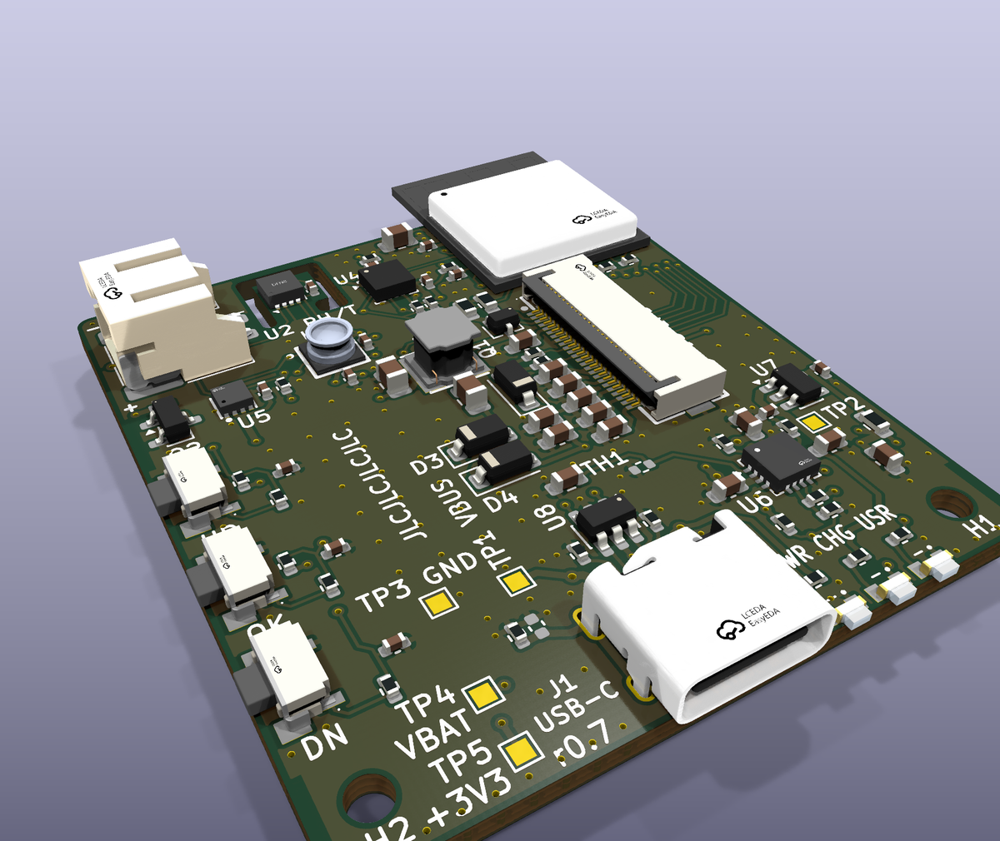
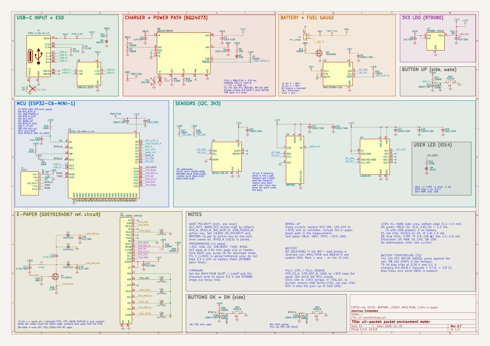

# ull-pocket

A pocket environment meter and learning board: ESP32-C6, temperature/humidity, pressure and motion sensors, a 1.54" e-paper display and a 600 mAh LiPo. It sleeps most of the time; buttons, motion or a timer wake it, and Wi-Fi only runs when the firmware asks for it.



## Hardware

| Block | Part |
|---|---|
| MCU | ESP32-C6-MINI-1-N4 (Wi-Fi 6, BLE, 802.15.4, 4 MB flash) |
| Temperature / humidity | Sensirion SHT31, on a moated island away from the heat sources |
| Pressure | Bosch BMP585 |
| Motion / wake | ST LIS3DH accelerometer |
| Battery | 600 mAh 1S LiPo (503040), JST-PH 2.0; MAX17048 fuel gauge; low-side reverse-polarity FET |
| Charging | TI BQ24073 power path, ~270 mA from USB-C |
| 3.3 V | Richtek RT9080 LDO, ~2 uA quiescent |
| Display | Good Display GDEY0154D67, 200x200 black/white e-paper, SSD1681, bought separately |
| Input | 3 side buttons UP / OK / DN (UP and OK wake from deep sleep; DN doubles as BOOT) |
| LEDs | Power (green), charge (red), user (blue), side-view at the bottom edge |
| Programming | USB-C (native USB Serial/JTAG) or 2x3 pogo pads on the back |

Board: 40 x 44.5 mm, 4 layers, 1.6 mm (JLC04161H-3313 stackup), all parts on the front; the panel sits on the back.

## Files

| Path | Contents |
|---|---|
| `ull-pocket.kicad_pro` | KiCad 10 project (schematic + board) |
| `lib/` | Project symbols, footprints and 3D models |
| `production/` | JLCPCB Gerbers, BOM and CPL: single board (`ull-pocket-r0.7-*`) and the assembly panel (`ull-pocket-r0.7-panel-*`, made by `tools/panelize.sh`) |
| `PARTS.md` | Parts list with LCSC numbers and design notes |
| `DATASHEETS.md` | Datasheet links |
| `docs/mechanical.md` | Outline, keep-outs, panel, battery and button positions for a case |
| `docs/3d-models.md` | 3D models checked against the datasheets |
| `production/ull-pocket-r0.7-assembly.pdf` | Assembly drawing: every part with its reference. The silkscreen labels ICs, connectors, buttons, LEDs and test points only; look resistors and capacitors up here |
| `docs/best-practices.md` | Schematic, layout, DFM and silkscreen checklist with sources, and how this board was checked against it |
| `tools/` | Checks and exports: ERC and netlist checks, JLC export, renders (`tools/archive/` holds the retired schematic generator) |



## Ordering

Order the **panel**: one board with 5 mm rails on the left and right (tooling holes and fiducials) and mouse-bite tabs, made by `tools/panelize.sh` (needs KiKit). The rails are only left and right because parts overhang the top and bottom edges; JLC's own rails could collide with them.

1. Upload `production/ull-pocket-r0.7-panel-gerbers.zip` to JLCPCB and set:
   - 4 layers, 1.6 mm, stackup JLC04161H-3313, impedance control not needed
   - surface finish **ENIG** (the LGA/QFN/DFN parts need a flat finish; HASL is the default)
   - min via hole / diameter **0.2 / 0.45 mm**; via covering: tented
   - order number: **specify a position** (the `JLCJLCJLCJLC` text on the front silkscreen)
   - panel by customer (1 board per panel), edge rails: none (already in the files)
2. Enable PCB assembly (top side) and upload `ull-pocket-r0.7-panel-bom.csv` and `ull-pocket-r0.7-panel-cpl.csv`.
3. Add a remark: "Customer panel with left/right rails and mouse bites. Components overhang the board edge: ESP32 module antenna 5.4 mm (top edge), USB-C 0.6 mm and side LEDs 0.4 mm (bottom edge), side buttons 0.2 mm (left edge)."
4. Check the part rotations in JLC's preview against `production/rotation-check.md`, and D1/D5/D6 against `docs/3d-models.md` (lens toward the board edge, cathode on pad 1).
5. Buy separately: the e-paper panel (GDEY0154D67), a 503040 LiPo with a protection board (check its plug polarity: pin 2 = +), and a 3 mm thermal gap pad for TH1 (see `docs/mechanical.md`).

## Programming

Plug in USB-C. The ESP32-C6 shows up as a USB serial port and esptool, Arduino or ESP-IDF flash it with no buttons: target `esp32c6` (Arduino: "ESP32C6 Dev Module", USB CDC On Boot enabled).

USB is off while the chip is in deep sleep, so keep the firmware awake while `USB_PGOOD_N` (IO1) is low (cable plugged in).

**Recovery:** if the firmware crashes, sleeps or disables USB before it can be flashed, unplug USB and the battery, hold **DN** (it is also BOOT, IO9), and plug USB back in. The chip starts in its ROM download mode; flash as usual, then reset by unplugging. The back pogo pads (J4) carry EN, BOOT and UART0 for a pogo fixture.

## Opening in KiCad

### 1. Install KiCad 10

Download KiCad 10.0 or newer from [kicad.org/download](https://www.kicad.org/download/) and use the default install, which includes the standard symbol, footprint and 3D-model libraries. KiCad 9 and older cannot open these files.

- **Windows / macOS:** run the installer.
- **Ubuntu / Debian:**
  ```sh
  sudo add-apt-repository ppa:kicad/kicad-10.0-releases
  sudo apt install kicad kicad-footprints kicad-symbols kicad-packages3d
  ```
  `kicad-packages3d` is needed for the 3D viewer.

On the very first start KiCad asks how to configure the global library tables: choose **Copy default global library table**.

### 2. Get the files

```sh
git clone https://github.com/ullnorse/ull-pocket.git
```

or use **Code → Download ZIP** on GitHub and unzip it.

### 3. Open the project

Open `ull-pocket.kicad_pro` (double-click it, or **File → Open Project** in KiCad). From the project window:

- **Schematic Editor** shows the schematic (one A3 sheet).
- **PCB Editor** shows the board. **View → 3D Viewer** (Alt+3) shows the assembled board.

No library setup is needed. The project's own symbols, footprints and 3D models are in `lib/` and are registered by the project-level `sym-lib-table` and `fp-lib-table` (paths are relative, via `${KIPRJMOD}`). Everything else comes from KiCad's standard libraries.

Keep the folder structure intact: KiCad finds `lib/` relative to the `.kicad_pro` file. If footprints or 3D models show as missing, check **Preferences → Manage Footprint Libraries → Project Specific Libraries** lists `ull-pocket` and that the folder was not moved.

### 4. Editing

- **Board:** edit freely in the PCB Editor. Run **Inspect → Design Rules Checker** before ordering. Custom rules are in `ull-pocket.kicad_dru` (side-LED edge clearance, e-paper high-voltage clearance, the thin traces on the SHT31 island, U6 thermal vias). Expect 4 harmless "footprint does not match library" warnings for parts edited on purpose.
- **Schematic and symbols:** edit them in the Schematic Editor and Symbol Editor. The project's symbols are in `lib/ull-pocket.kicad_sym`.
- After a schematic change, update the board with **Tools → Update PCB from Schematic** (F8) in the PCB Editor.

### 5. Regenerating production files

In KiCad: **File → Fabrication Outputs** (Gerbers, drill files, component placement). The JLCPCB-formatted files in `production/` are made by scripts, on Linux with KiCad 10 and Python 3:

```sh
sh tools/jlc_export.sh                     # Gerbers + drill files -> production/*-gerbers.zip
python3 tools/jlc_cpl.py ull-pocket.kicad_pcb <easyeda-cache> production   # BOM + CPL with JLC rotations
sh tools/panelize.sh                       # assembly panel -> build/panel/ull-pocket-panel.kicad_pcb (pipx install kikit)
sh tools/jlc_export.sh build/panel/ull-pocket-panel.kicad_pcb ull-pocket-r0.7-panel
python3 tools/jlc_cpl.py build/panel/ull-pocket-panel.kicad_pcb <easyeda-cache> production ull-pocket-r0.7-panel
python3 tools/silk/assembly.py ull-pocket.kicad_pcb production/ull-pocket-r0.7-assembly.pdf
sh tools/check_sch.sh                      # ERC, netlist checks, pin/pad checks, schematic PDF + PNG
sh tools/render3d.sh                       # 3D renders -> build/render3d/
```

`jlc_cpl.py` compares each footprint with JLC's own (EasyEDA) footprint to get placement rotations; fetch those once per LCSC part with `easyeda2kicad --footprint --lcsc_id=Cxxx --output=<easyeda-cache>/Cxxx/lib` (`pip install easyeda2kicad`). `check_sch.sh` also needs `rsvg-convert` (`sudo apt install librsvg2-bin`). `tools/check_net.py` encodes the intended connections; update it when you change the circuit on purpose.

## License

CERN-OHL-P v2, see [LICENSE](LICENSE).
