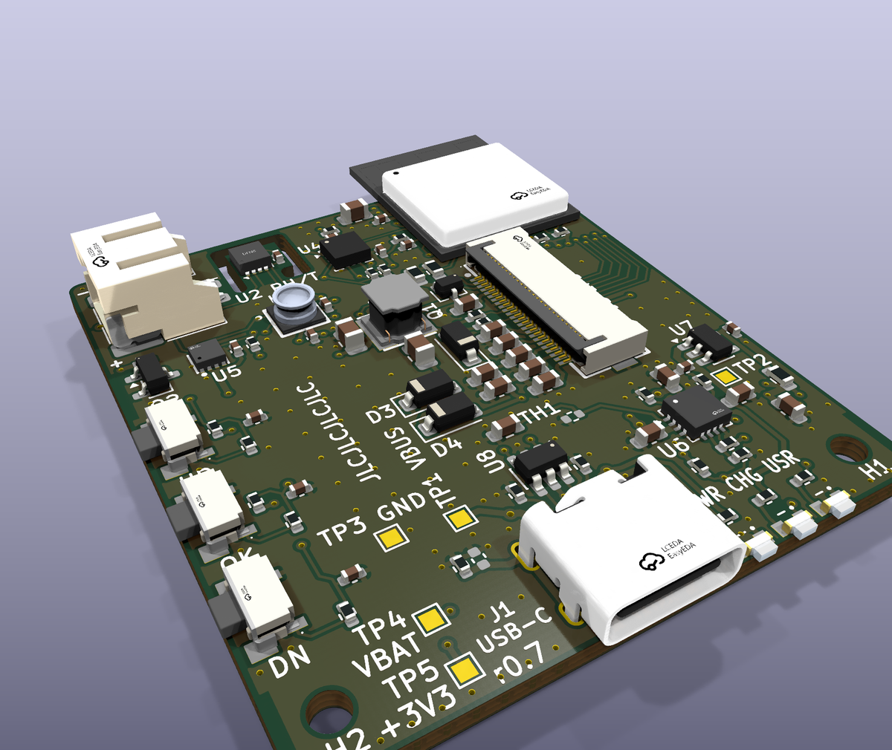
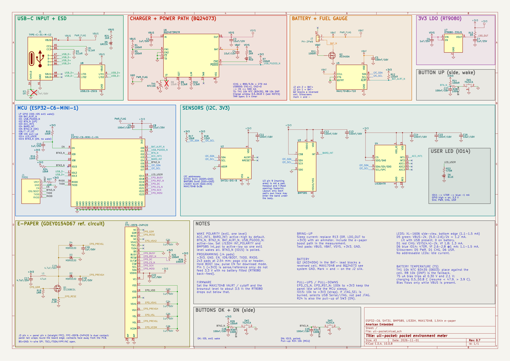

# ull-pocket

A pocket environment meter and learning board: ESP32-C6, temperature/humidity, pressure and motion sensors, a 1.54" e-paper display and a 1200 mAh LiPo. It sleeps most of the time; buttons, motion or a timer wake it, and Wi-Fi only runs when the firmware asks for it.



## Hardware

| Block | Part |
|---|---|
| MCU | ESP32-C6-MINI-1-N4 (Wi-Fi 6, BLE, 802.15.4, 4 MB flash) |
| Temperature / humidity | Sensirion SHT40, on a moated island away from the heat sources |
| Pressure | Bosch BMP580 |
| Motion / wake | ST LIS2DW12 accelerometer |
| Battery | 1200 mAh 1S LiPo (103040), 1.25 mm plug; MAX17048 fuel gauge; low-side reverse-polarity FET |
| Charging | TI BQ24073 power path, ~270 mA from USB-C, about 5-6 h for a full charge |
| 3.3 V | Richtek RT9080 LDO, ~2 uA quiescent |
| Display | Good Display GDEY0154D67, 200x200 black/white e-paper, SSD1681, bought separately |
| Input | 3 side buttons UP / OK / DN (UP and OK wake from deep sleep; DN doubles as BOOT) |
| LEDs | Power (green), charge (red), user (red/blue), side-view at the bottom edge |
| Programming | USB-C (native USB Serial/JTAG) or 2x3 pogo pads on the back |

Board: 40 x 44.5 mm, 4 layers, 1.6 mm (JLC04161H-3313 stackup), all parts on the front; the panel sits on the back.

## Files

| Path | Contents |
|---|---|
| `boards/ull-pocket/ull-pocket.kicad_pro` | KiCad project (schematic + board), rev 0.10, saved by Backplane's KiCad |
| `boards/ull-pocket/lib/` | Project symbols, footprints and 3D models |
| `mfg/` | Rev 0.9 fabrication outputs, kept for reference: single board (`ull-pocket-r0.9-*`) and the old assembly panel (`ull-pocket-r0.9-panel-*`). Rev 0.10 files are exported when the board is ordered |
| `mech/` | Case draft (front shell, back cover, button plungers): FreeCAD scripts and STEP files |
| `PARTS.md` | Parts list with LCSC numbers and design notes |
| `DATASHEETS.md` | Datasheet links |
| `docs/mechanical.md` | Outline, keep-outs, panel, battery and button positions for a case |
| `docs/3d-models.md` | 3D models checked against the datasheets |
| `mfg/ull-pocket-r0.9-assembly.pdf` | Assembly drawing (rev 0.9, before the fiducials): every part with its reference. The silkscreen labels ICs, connectors, buttons, LEDs and test points only; look resistors and capacitors up here |
| `docs/learn.html` | Interactive course: understand every part of the board, from zero |
| `docs/best-practices.md` | Schematic, layout, DFM and silkscreen checklist with sources, and how this board was checked against it |



## Ordering

The board is ordered through Backplane (the **Buy it** button), which exports the fabrication files from `boards/ull-pocket/` and gets the quote. Board options are in `boards/ull-pocket/ull-pocket.fab.json`: 4 layers, 1.6 mm, stackup JLC04161H-3313, **ENIG** (the LGA/QFN/DFN parts need a flat finish), green, vias down to 0.2 / 0.45 mm.

What the fab's assembly needs (JLCPCB's published capabilities and help pages, read 2026-11-19):

- **Standard PCBA is required.** U1, U3, U4 and D1 are listed as Standard-only, and one such part moves the whole order to Standard.
- **Standard PCBA takes boards or panels from 70 x 70 mm**, and needs edge rails and fiducials. This board is 40 x 44.5 mm. For a smaller board the fab adds 5 mm process rails on two sides by default (V-cut, delivered attached unless asked otherwise).
- **Rails can only go on the left and right.** Parts overhang the other edges: ESP32 module antenna 5.4 mm (top), USB-C 0.6 mm, D1/D5 LEDs 0.4 mm and RGB D6 0.65 mm (bottom). The side buttons overhang the left edge by 0.2 mm. Copper is 0.3 mm from the left and right edges, under the 0.4 mm the fab asks for next to a V-cut, so rails joined with mouse-bite tabs are the safe choice.
- **Fiducials** FID1-FID3 are on the board (1 mm copper, 2 mm opening). Rails need their own fiducials and tooling holes.

So either order a customer panel that reaches 70 x 70 mm with left/right rails on mouse-bite tabs, or order the bare board with this remark and let the fab's engineers add the rails: "Rails on the left and right edges only, joined with mouse bites. Components overhang the board edge: ESP32 module antenna 5.4 mm (top edge), USB-C 0.6 mm, D1/D5 LEDs 0.4 mm and RGB D6 0.65 mm (bottom edge), side buttons 0.2 mm (left edge)." The rev 0.9 panel in `mfg/` (one board, 5 mm rails, about 54 x 44.5 mm) is under the 70 x 70 mm minimum.

Also:

1. Order number: **specify a position** (the `JLCJLCJLCJLC` text on the front silkscreen).
2. Check the part rotations in the fab's preview against `mfg/rotation-check.md`, and D1/D5/D6 against `docs/3d-models.md` (lens toward the board edge, cathode on pad 1).
3. Buy separately: the e-paper panel (GDEY0154D67), a 103040 LiPo with a protection board and 1.25 mm plug (check that it mates with J2 and its polarity: pin 2 = +), and a 3 mm thermal gap pad for TH1 (see `docs/mechanical.md`).
4. Separate boards from the rails by cutting the tabs, not bending: U1's pads and the VBAT track are about 1 mm from the edge.
5. Before first USB plug-in, check the cell's polarity. Q2 blocks a reversed cell on battery, but with USB in the charger slowly drains it through Q2.

## Programming

Plug in USB-C. The ESP32-C6 shows up as a USB serial port and esptool, Arduino or ESP-IDF flash it with no buttons: target `esp32c6` (Arduino: "ESP32C6 Dev Module", USB CDC On Boot enabled).

USB is off while the chip is in deep sleep, so keep the firmware awake while `USB_PGOOD_N` (IO1) is low (cable plugged in).

Firmware rules:
- Stop at a safe cell voltage: the cell's listing doesn't promise over-discharge protection.
- Enable the RTC watchdog: EN is only on the back pogo pads, so there's no reset button in the case.
- IO15 (CHG_DIS) high pauses charging. In deep sleep, hold it low or leave it as an input so R36 keeps charging on.
- Don't run Wi-Fi validation with no cell: the input limit leaves little margin over TX peaks.
- Ignore temperature and humidity while charging and until the case cools; measure how long that takes on the first board.

First-board power-up:
1. Power up without the panel. Check +3V3 at TP5.
2. Unpower the board, plug the panel in, and check continuity from GND (TP3) to the panel's VSS finger, the 17th from the pin-1 end. It must beep: a reversed tail would put about 20 V on the wrong panel pins.
3. Only then power up with the panel.

First-board charge test: compare TH1 with a thermocouple on the cell during a full charge. Board heat could still reach TH1's 47 C limit in a very warm room and pause charging (estimated, not measured). CHG flashing at 2 Hz means a timer fault; replug USB to clear it.

**Recovery:** if the firmware crashes, sleeps or disables USB before it can be flashed, unplug USB and the battery, hold **DN** (it is also BOOT, IO9), and plug USB back in. The chip starts in its ROM download mode; flash as usual, then reset by unplugging. The back pogo pads (J4) carry EN, BOOT and UART0 for a pogo fixture.

## Opening in KiCad

### 1. KiCad version

From rev 0.10 the board and schematic are saved by Backplane's KiCad (10.99), in a file format newer than KiCad 10.0 writes. Open them from Backplane (**Open in KiCad**), or with a KiCad build at least as new. KiCad 10.0 and older report the files as made by a newer version.

The last revision in KiCad 10.0 format is rev 0.9: check out commit `9e9c569` to open it with a stock KiCad 10 install from [kicad.org/download](https://www.kicad.org/download/).

### 2. Get the files

```sh
git clone https://github.com/ullnorse/ull-pocket.git
```

or use **Code → Download ZIP** on GitHub and unzip it.

### 3. Open the project

Open `boards/ull-pocket/ull-pocket.kicad_pro` (double-click it, or **File → Open Project** in KiCad). From the project window:

- **Schematic Editor** shows the schematic (one A3 sheet).
- **PCB Editor** shows the board. **View → 3D Viewer** (Alt+3) shows the assembled board.

No library setup is needed. The project's own symbols, footprints and 3D models are in `boards/ull-pocket/lib/` and are registered by the project-level `sym-lib-table` and `fp-lib-table` (paths are relative, via `${KIPRJMOD}`). Everything else comes from KiCad's standard libraries.

Keep the folder structure intact: KiCad finds `lib/` relative to the `.kicad_pro` file. If footprints or 3D models show as missing, check **Preferences → Manage Footprint Libraries → Project Specific Libraries** lists `ull-pocket` and that the folder was not moved.

### 4. Editing

- **Board:** edit freely in the PCB Editor. Run **Inspect → Design Rules Checker** before ordering. Custom rules are in `ull-pocket.kicad_dru` (side-LED edge clearance, e-paper high-voltage clearance, the thin traces on the SHT40 island, U6 thermal vias). DRC runs clean: the footprints edited on purpose (C12, U1, J1) live in the project library with an `_ull-pocket` suffix, and FID1-FID3 are board-only assembly fiducials.
- **Schematic and symbols:** edit them in the Schematic Editor and Symbol Editor. The project's symbols are in `boards/ull-pocket/lib/ull-pocket.kicad_sym`.
- After a schematic change, update the board with **Tools → Update PCB from Schematic** (F8) in the PCB Editor.

### 5. Regenerating production files

This project is developed with Backplane: its checks, exports and panelization produce the files in `mfg/`. Without it, KiCad's **File → Fabrication Outputs** makes Gerbers, drill files and the placement file.

## License

CERN-OHL-P v2, see [LICENSE](LICENSE).
